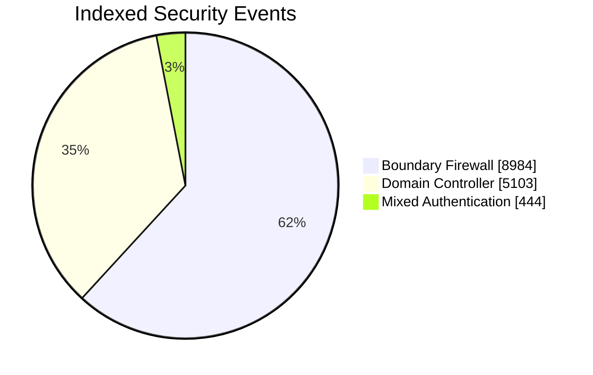
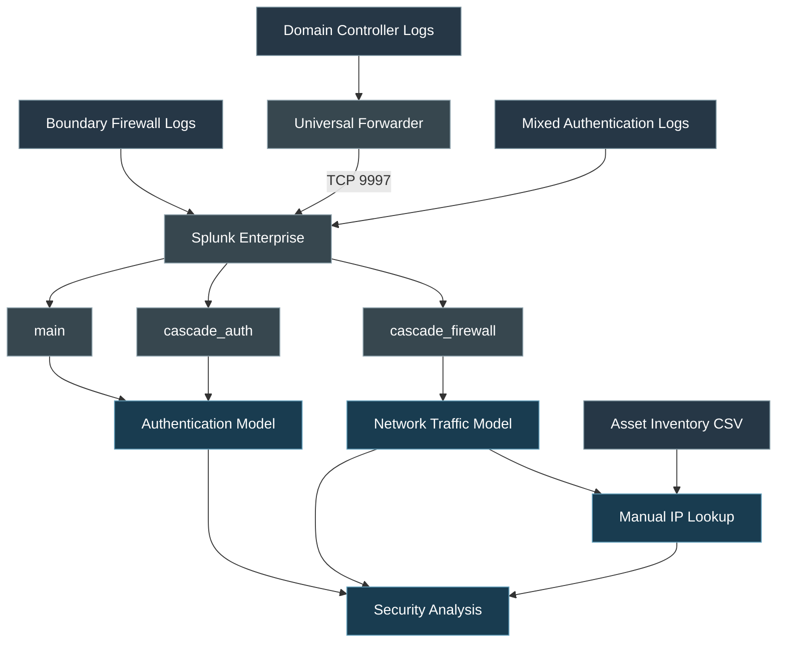
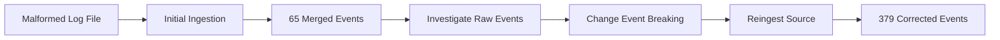
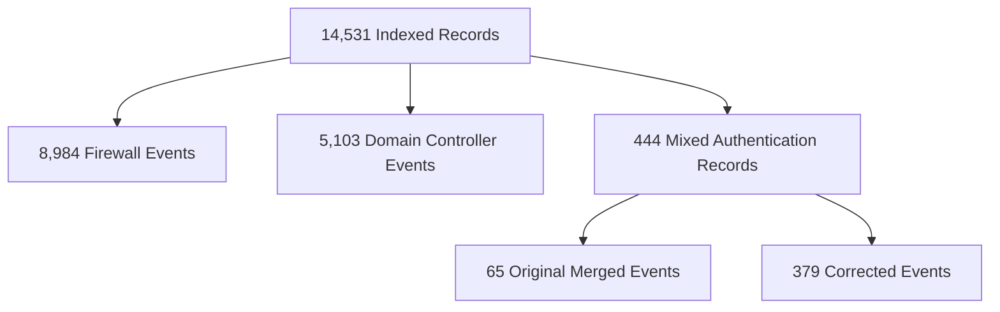

<h1 align="center">
A2 | Log Source Inventory<br>
and CIM Normalization
</h1>

<h3 align="center">
Cyber Defense and Analysis — CYDA 420
</h3>

<p align="center">
<strong>Infrastructure:</strong> Self-hosted Proxmox Homelab
<br>
<strong>Focus:</strong> Data Normalization and Log Integrity
<br>
<strong>Status:</strong> Implemented — Partial CIM Normalization
</p>

<hr>

<p align="center">

</p>

## 01 | Project Overview

This project builds upon the Splunk collection architecture 
implemented in A1. The primary objective was to expand log 
collection, implement the Splunk Common Information Model 
(CIM), and investigate inconsistencies within collected 
security data.

The lab focuses on preparing security telemetry for threat 
detection, identifying monitoring gaps, and understanding 
how unreliable log parsing and field normalization can 
affect security investigations.

All configurations and searches were performed within my 
self-hosted Proxmox homelab using supplied academic datasets.

---

## 02 | Implementation Results

| Metric | Result |
|---|---:|
| Log Sources | 3 |
| Splunk Indexes | 3 |
| Firewall Events | 8,984 |
| Domain Controller Events | 5,103 |
| Mixed Authentication Records | 444 |
| Total Indexed Records | 14,531 |
| Asset Inventory Entries | 60 |
| CIM Data Models Used | 2 |



The total includes both the original malformed ingestion 
and the corrected ingestion of the third log source.

---

## 03 | Collection and Normalization Architecture



---

## 04 | Technology Stack

| Technology | Purpose |
|---|---|
| Proxmox VE | Virtualization infrastructure |
| Ubuntu Server | Splunk hosting environment |
| Splunk Enterprise | Security information and event management |
| Universal Forwarder | Authentication log forwarding |
| Splunk CIM | Standardized security data models |
| SPL | Searching, extraction, and validation |
| Regular Expressions | Search-time field extraction |
| CSV Lookup | Asset identification and enrichment |
| NERC CIP-007-7.1 | Security monitoring compliance assessment |

---

## 05 | Log Source Inventory

| Source | Index | Sourcetype | CIM Model |
|---|---|---|---|
| Boundary Firewall | cascade_firewall | cascade:fw:boundary | Network Traffic |
| Domain Controller | cascade_auth | cascade:dc:security | Authentication |
| Mixed Authentication | main | cascade:auth:sample | Authentication — SSH subset |

### Source Files

```text
cascade_fw01_boundary.log
cascade_dc01_security.log
cascade_auth_log_sample.log
cascade_assets.csv
```

Each source provides different visibility into the 
environment. Normalizing these sources allows security 
analysts to investigate events using more consistent 
field names and search structures.

---

## 06 | Common Information Model Implementation

### Phase 1 — CIM Installation

I installed the Splunk Common Information Model add-on 
within my existing Splunk Enterprise environment.

The two data models used throughout this lab were:

- Network Traffic
- Authentication

The CIM add-on version was not independently verified.

### Phase 2 — Firewall Normalization

| Configuration | Value |
|---|---|
| Event Type | cascade_firewall |
| Tags | network, communicate |
| CIM Model | Network Traffic |
| Field Alias | proto → transport |

The firewall contained native key-value fields that 
provided a foundation for network traffic normalization.

#### Validation Query

```spl
| datamodel Network_Traffic All_Traffic search
| search sourcetype="cascade:fw:boundary"
| rename All_Traffic.* AS *
| table _time src dest action src_port dest_port transport
```

#### Results

- 8,984 firewall events available.
- Source and destination information populated.
- Network ports available for investigation.
- Transport protocol mapped through a field alias.
- Action values remained allow and deny.

The firewall successfully returned events through the 
Network Traffic data model, although action vocabulary 
was not fully standardized.

### Phase 3 — Domain Controller Normalization

| Configuration | Value |
|---|---|
| Event Type | cascade_dc_authentication |
| Tag | authentication |
| CIM Model | Authentication |

Windows authentication events were classified using 
successful and unsuccessful logon event codes.

| Event Code | Meaning |
|---|---|
| 4624 | Successful logon |
| 4625 | Failed logon |

#### Event Type Search

```spl
sourcetype="cascade:dc:security"
(EventCode=4624 OR EventCode=4625
OR EventID=4624 OR EventID=4625)
```

#### Validation Query

```spl
| datamodel Authentication Authentication search
| search sourcetype="cascade:dc:security"
| table _time Authentication.user
    Authentication.src Authentication.dest
    Authentication.action
```

Authentication actions were successfully represented 
in the data model. However, user, source, and destination 
fields remained unknown in the captured results.

This source required additional field-mapping work 
before it could support reliable identity-based 
investigations.

---

## 07 | Malformed Log Source Investigation

The third source contained multiple timestamp formats 
and different categories of system activity.

During initial ingestion, Splunk combined multiple 
physical log lines into individual events.

### Before and After

| Configuration | Initial | Corrected |
|---|---|---|
| Event Breaking | Automatic | Every line |
| Timestamp Recognition | Automatic | Automatic |
| Events Returned | 65 | 379 |
| Event Separation | Inconsistent | Improved |



### Timestamp Analysis

| Timestamp Category | Corrected Events |
|---|---:|
| Unix Epoch | 65 |
| ISO Format | 109 |
| Proxy / Apache Format | 62 |
| Yearless Switch Format | 83 |
| HMI Timestamp Without Timezone | 60 |
| Total | 379 |

The timestamp validation used UTC and the year 2026 
where the source did not explicitly provide the 
necessary information.

These were documented assumptions rather than 
independently verified device settings.

### Ingestion Limitation

The original 65 merged events remained indexed after 
the corrected ingestion.

As a result, the sourcetype contained 444 indexed 
records rather than only the corrected 379 events.

---

## 08 | Search-Time Field Extraction

The mixed authentication source required regular 
expressions to extract information from SSH events.

```spl
| datamodel Authentication Authentication search
| search sourcetype="cascade:auth:sample"
| rex field=_raw "(?<dest>[\w.-]+)\s+sshd\[\d+\]:\s+(?<result>Accepted|Failed)\s+\S+\s+for\s+(?:invalid user\s+)?(?<user>\S+)\s+from\s+(?<src>\S+)"
| eval action=case(
    result="Accepted","success",
    result="Failed","failure")
| where isnotnull(user)
| table _time user src dest action
```

### Extracted Fields

| Field | Purpose |
|---|---|
| user | Account associated with authentication |
| src | Originating IP address |
| dest | Destination hostname |
| action | Authentication success or failure |
| _time | Parsed event timestamp |

The search returned 239 SSH authentication records 
with populated fields.

These extractions were performed at search time. 
Persistent normalization across the entire mixed 
source was not established, and duplicate ingestion 
may affect the returned count.

---

## 09 | Asset Inventory and Enrichment

I imported a CSV inventory containing 60 assets 
to provide additional context during investigations.

### Asset Attributes

| Attribute | Purpose |
|---|---|
| hostname | Device identification |
| ip | Network address |
| site | Physical or organizational location |
| zone | Network security zone |
| owner | Responsible team |
| criticality | Asset importance |

### Asset Enrichment Query

```spl
index=* sourcetype="cascade:fw:boundary"
| lookup cascade_assets.csv ip AS src
    OUTPUT site zone owner criticality
| where isnotnull(site)
| table _time src dest action site zone owner criticality
```

The lookup enriched matching firewall events with 
asset ownership, location, and criticality information.

The lookup was manually invoked and was not verified 
as an automatic enrichment configuration across 
all three sources.

---

## 10 | Troubleshooting and Problem Resolution

<details>
<summary><strong>Issue 01 | Incorrect Event Breaking</strong></summary>

### Symptoms

Multiple physical log lines appeared within individual 
Splunk events. Initial ingestion returned only 65 events.

### Investigation

Reviewed raw event contents and identified unrelated 
system messages grouped together.

### Resolution

Changed event breaking from Automatic to Every line 
and reingested the source.

### Outcome

The corrected ingestion returned 379 events.

</details>

<details>
<summary><strong>Issue 02 | Inconsistent Timestamp Formats</strong></summary>

### Symptoms

The source contained five different categories of 
timestamp formats, including timestamps without a 
year or timezone.

### Investigation

Compared parsed timestamps across the corrected 
ingestion and identified the assumptions required 
for interpretation.

### Resolution

Retained automatic timestamp recognition and validated 
parsed timestamps using UTC and 2026 assumptions.

### Limitation

The source device timezone settings were not 
independently verified.

</details>

<details>
<summary><strong>Issue 03 | Missing CIM Authentication Fields</strong></summary>

### Symptoms

Domain controller events appeared in the Authentication 
data model, but user, source, and destination fields 
remained unknown.

### Investigation

Attempted field aliases, calculated fields, event 
classification, and authentication tagging.

### Outcome

Authentication action mapping was established, but 
identity-related fields remained incomplete.

### Status

Partially resolved — additional mapping required.

</details>

<details>
<summary><strong>Issue 04 | Duplicate Indexed Data</strong></summary>

### Symptoms

After reingestion, the mixed authentication sourcetype 
contained 444 indexed records.

### Cause

The original 65 malformed events remained alongside 
the 379 corrected events.

### Validation

Used indexing time to distinguish the corrected 
ingestion from the original ingestion.

### Status

Identified — duplicate records remain indexed.

</details>

<details>
<summary><strong>Issue 05 | Mixed Authentication Field Extraction</strong></summary>

### Symptoms

The third source contained SSH authentication, 
privileged commands, web activity, and other 
system events.

### Resolution

Used regular expressions and calculated action 
values to extract SSH authentication information.

### Outcome

239 authentication records were returned by the 
search-time extraction query.

### Status

SSH extraction implemented; persistent and non-SSH 
normalization remain incomplete.

</details>

---

## 11 | Data Validation

### Combined Log Source Inventory

```spl
index=*
(sourcetype="cascade:fw:boundary"
OR sourcetype="cascade:dc:security"
OR sourcetype="cascade:auth:sample")
| stats count by index source sourcetype
```

### Indexed Record Distribution



---

## 12 | Security Monitoring and Compliance Gaps

| Source | Monitoring Limitation | Threat Affected | Gap Type |
|---|---|---|---|
| Firewall | Limited payload and internal network visibility | Lateral movement and exfiltration | Detection and compliance |
| Domain Controller | Incomplete identity field normalization | Password spraying and stolen accounts | Detection and compliance |
| Mixed Authentication | Non-SSH activity not fully normalized | Unauthorized privileged access | Detection and compliance |

### NERC CIP-007-7.1 Assessment

| Source | Coverage Assessment |
|---|---|
| Boundary Firewall | Partial |
| Domain Controller | Partial |
| Mixed Authentication | Partial |

The presence of security logs does not automatically 
establish regulatory compliance. Complete event 
coverage, accurate normalization, system applicability, 
and reliable collection must also be considered.

---

## 13 | Analyst Interpretation

One of the most important findings from this lab was 
that successfully ingesting logs does not necessarily 
mean the information is ready for security analysis.

Incorrect event breaking can combine unrelated events, 
while incomplete field mappings can prevent an analyst 
from identifying the account or device associated 
with suspicious activity.

Comparing normalized results against raw logs is 
important when investigating potential data integrity 
issues or intentionally corrupted field mappings.

The collection architecture provides useful IT 
visibility, but direct OT monitoring and complete 
security event coverage remain outside the scope 
of this implementation.

---

## 14 | Technical Skills Demonstrated

| Skill | Practical Application |
|---|---|
| SIEM Administration | Management of indexed security data |
| CIM Normalization | Authentication and Network Traffic models |
| SPL Development | Searches, validation, and data enrichment |
| Regular Expressions | Authentication field extraction |
| Log Troubleshooting | Identification of merged events |
| Timestamp Analysis | Validation across inconsistent formats |
| Asset Management | CSV-based security context |
| Security Analysis | Identification of monitoring blind spots |
| Compliance Awareness | Assessment of security event coverage |
| Technical Documentation | Configuration and troubleshooting records |

---

## 15 | Supporting Documentation

The original academic report contains the detailed 
log source inventory, configuration evidence, 
screenshots, malformed source analysis, and analyst 
interpretation.

[View Final Academic Report](./Final_Report_README.md)

---

## 16 | Future Improvements

- Complete persistent domain controller field mappings.
- Standardize firewall action values.
- Remove or isolate duplicate indexed records.
- Extend normalization beyond SSH authentication.
- Implement automatic asset enrichment.
- Expand visibility into additional network sources.
- Develop threat detection and correlation searches.

---

## 17 | AI Transparency

I used ChatGPT to help me move through the lab and 
better understand what was being asked of me. AI 
helped me troubleshoot issues I came across, understand 
the CIM configurations, work through SPL queries, 
figure out what screenshots I needed, and organize 
my technical documentation.

I performed the configurations, ran the searches, 
reviewed the results, and collected the screenshots 
within my own Splunk environment.

---

<p align="center">
<strong>Cyber Defense and Analysis | Security Monitoring Portfolio</strong>
</p>
