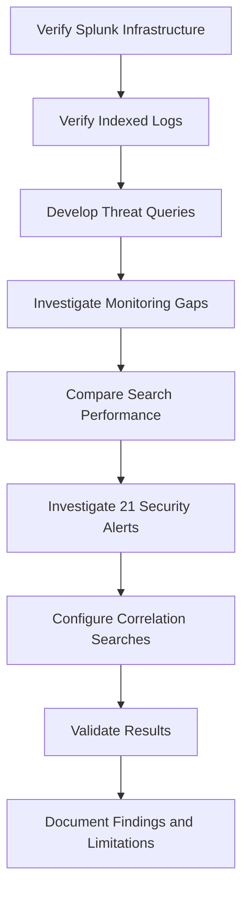

<h1 align="center">
A3 | SPL Query Library, Alert Triage<br>
and Correlation Searches
</h1>

<h3 align="center">
Implementation and Technical Lab Journal
</h3>

<p align="center">
<strong>Infrastructure:</strong> Self-hosted Proxmox Homelab
<br>
<strong>Platform:</strong> Splunk Enterprise
<br>
<strong>Role:</strong> Grid Security Analyst
<br>
<strong>Status:</strong> Implemented — Partial Detection Validation
</p>

<hr>

## 01 | Project Objective

The objective of this lab was to build upon the security
monitoring infrastructure and log normalization work I
completed in A1 and A2.

During this lab, I developed SPL queries to identify
potential threats, investigate monitoring gaps, triage
security alerts, and configure scheduled correlation searches.

This document records the steps I took, the issues I ran
into, how I troubleshot those issues, and the results I
obtained throughout the implementation.

---

## 02 | Infrastructure and Prerequisites

I continued using the Splunk environment previously
configured within my Proxmox homelab.

| Component | Configuration |
|---|---|
| Hypervisor | Proxmox VE |
| Operating System | Ubuntu Server |
| SIEM | Splunk Enterprise |
| Log Forwarding | Splunk Universal Forwarder |
| Search Language | SPL |
| Scenario | Cascade Electric |
| Analyst Role | Grid Security Analyst |

Before starting, the following components were required:

- A running Ubuntu Server virtual machine.
- Access to Splunk Enterprise.
- Previously indexed Cascade security logs.
- The Cascade asset inventory lookup.
- The Cascade alert queue CSV.
- The log normalization configuration completed in A2.

### Implementation Workflow



---

## 03 | Initial Infrastructure Issue

### Objective

Before developing my SPL queries, I needed to verify
that my Splunk environment was functioning correctly.

### Issue Encountered

While attempting to work in Splunk, I encountered an
issue with the available disk space on my Ubuntu VM.

This prevented me from continuing with my searches.

Instead of reinstalling Splunk or creating another
virtual machine, I investigated the available storage
within the existing operating system.

### Step 1 — Check Disk Usage

```bash
df -h
```

This command displays mounted filesystems and their
available storage.

My root filesystem was approximately 24 GB in size,
with approximately 4.9 GB remaining.

### Step 2 — Investigate Logical Volume Storage

```bash
sudo vgs
```

```bash
sudo lvs
```

These commands allow me to inspect the volume groups
and logical volumes configured through Linux LVM.

I identified approximately 24 GB of available space
within the volume group.

The additional storage was available but had not
been allocated to my root logical volume.

### Step 3 — Expand the Logical Volume

```bash
sudo lvextend -r -L +20G /dev/ubuntu-vg/ubuntu-lv
```

| Argument | Purpose |
|---|---|
| lvextend | Expands an existing logical volume |
| -r | Resizes the filesystem |
| -L +20G | Adds 20 GB of storage |
| /dev/ubuntu-vg/ubuntu-lv | Target logical volume |

> The logical volume path and available volume group
> storage must be verified before running this command
> in another environment.

### Step 4 — Verify the Expansion

```bash
df -h
```

### Actual Result

I successfully expanded the logical volume by 20 GB
and was able to continue working in Splunk.

### Lessons Learned

Increasing or allocating storage to a virtual machine
does not always mean that the storage is immediately
available to the operating system.

Understanding how Linux partitions, volume groups,
logical volumes, and filesystems work is important
when troubleshooting self-hosted infrastructure.

**Status: Resolved**

---

## 04 | Verifying Indexed Log Sources

After resolving the storage issue, I needed to verify
which logs were available within Splunk.

### Step 1 — Open Search and Reporting

1. Access Splunk Enterprise.
2. Navigate to Search & Reporting.
3. Change the search time range to All time.
4. Execute the following query.

```spl
| tstats count WHERE index=* BY index sourcetype
```

### Actual Results

| Index | Sourcetype | Events |
|---|---|---:|
| cascade_auth | cascade:dc:security | 5,103 |
| cascade_firewall | cascade:fw:boundary | 8,984 |
| main | cascade:auth:sample | 444 |
| Total | | 14,531 |

### Step 2 — Verify Historical Coverage

```spl
| tstats count min(_time) AS first_event
max(_time) AS last_event WHERE index=*
BY index sourcetype
| convert ctime(first_event) ctime(last_event)
```

### Results

| Log Source | Approximate Coverage |
|---|---:|
| Firewall | 14 days |
| Windows Authentication | 10 days |
| Mixed Authentication Sample | 0.97 days |

### Findings

Although the logs were successfully indexed, the
available data did not provide a complete 30-day
record of network activity.

Dedicated DNS and VPN logs were also unavailable
within my indexed environment.

This became an important limitation later in the
alert investigation process.

The absence of these sources in my lab does not
independently establish that they were absent from
the original Cascade monitoring architecture.

---

## 05 | Threat-Targeting Query Development

After verifying the available data, I began developing
queries targeting suspicious authentication and
network activity.

All searches were executed using the All time setting.

### Threat-Targeting Query 1 — Failed Authentication

```spl
index=cascade_auth sourcetype="cascade:dc:security" EventCode=4625
| stats count AS failed_attempts by Account_Name Source_Network_Address
| sort - failed_attempts
```

### Purpose

Identify accounts experiencing repeated authentication
failures and determine the associated source IP addresses.

### Actual Results

| Account | Source IP | Failed Attempts |
|---|---|---:|
| engineer_j.kowalski | 10.20.14.52 | 7 |
| engineer_a.brandt | 10.20.14.49 | 6 |
| it_admin_g.park | 10.20.19.7 | 6 |
| it_admin_v.rao | 10.20.19.8 | 6 |

Total matching events: 90.

The search produced 25 account and source IP combinations.

### Interpretation

Repeated authentication failures could indicate password
spraying, brute-force attempts, or normal user mistakes.

The results alone were not enough to confirm that an
attack had occurred.

### Screenshot Checkpoint 1

Capture the Splunk search window showing:

- Complete SPL query.
- All time search range.
- Returned event count.
- Statistics table.

---

### Threat-Targeting Query 2 — Service Account Activity

```spl
index=cascade_auth sourcetype="cascade:dc:security" EventCode=4624 Account_Name=svc_*
| stats count by Account_Name Source_Network_Address Workstation_Name ComputerName
| sort - count
```

### Actual Results

| Account | Source IP | Successful Logons |
|---|---|---:|
| svc_historian | 10.22.88.99 | 2,880 |
| svc_scada | 10.20.50.5 | 240 |

Total matching events: 3,120.

### Interpretation

I investigated service account activity because compromised
valid accounts can allow an attacker to move through
an environment without immediately generating obvious
authentication failures.

However, the high number of successful authentications
could also represent normal automated service activity.

---

### Threat-Targeting Query 3 — Large Data Transfers

```spl
index=cascade_firewall sourcetype="cascade:fw:boundary" action=allow
| where bytes_out > 1000000
| stats count AS connections sum(bytes_out) AS total_bytes_out by src dest dest_port app
| sort - total_bytes_out
```

### Actual Results

| Source | Destination | Port | Connections | Bytes Out |
|---|---|---:|---:|---:|
| 10.20.30.8 | 10.20.60.20 | 22 | 14 | 48,487,216,322 |
| 10.20.50.5 | 198.51.100.44 | 443 | 1 | 41,650,000 |

### Interpretation

I identified approximately 48.49 GB of internal SSH
traffic and approximately 41.65 MB of traffic directed
toward an external address.

The one-million-byte threshold was used as an initial
investigative filter rather than an established
production detection threshold.

The firewall logs did not establish what information
was transferred or whether the transfers were authorized.

---

### Threat-Targeting Query 4 — Network Reconnaissance

```spl
index=cascade_firewall sourcetype="cascade:fw:boundary" action=deny
| stats count AS denied_connections dc(dest_port) AS unique_ports dc(dest) AS unique_destinations by src
| sort - denied_connections
| head 20
```

### Actual Results

| Source IP | Denied Connections | Unique Ports | Destinations |
|---|---:|---:|---:|
| 10.20.14.33 | 169 | 22 | 14 |
| 203.0.113.77 | 40 | 2 | 1 |
| 10.20.30.40 | 14 | 5 | 12 |

### Interpretation

The source address 10.20.14.33 stood out because of
the number of denied connections, destination ports,
and systems it attempted to reach.

This activity could indicate network reconnaissance,
but additional investigation would be required before
classifying it as malicious.

---

## 06 | Monitoring Gap Investigation

The next stage involved investigating limitations
identified during my previous A2 assignment.

### Gap-Probing Query 1 — Firewall Historical Coverage

```spl
index=cascade_firewall sourcetype="cascade:fw:boundary"
| stats count AS total_events min(_time) AS first_event max(_time) AS last_event
| eval coverage_days=round((last_event-first_event)/86400,2)
| convert ctime(first_event) ctime(last_event)
| eval required_days=30
| eval missing_days=round(required_days-coverage_days,2)
```

### Actual Results

| Measurement | Result |
|---|---:|
| Total Events | 8,984 |
| Available Coverage | 14 days |
| Required Investigation Period | 30 days |
| Coverage Shortfall | 16 days |

### Interpretation

The firewall records only covered approximately
14 days of the required 30-day investigation period.

This prevented me from establishing what occurred
throughout the entire requested period.

This query measures the time between the earliest
and latest available events, not configured retention
or uninterrupted collection.

### Screenshot Checkpoint 2

Capture the query and statistics table showing the
available coverage and the 16-day shortfall.

---

### Additional Investigation — Authentication Coverage

I repeated the historical coverage investigation
against the Windows authentication logs and the
mixed authentication sample.

| Log Source | Coverage | 30-Day Shortfall |
|---|---:|---:|
| Windows Authentication | 10 days | 20 days |
| Mixed Authentication Sample | 0.97 days | 29.03 days |

These additional searches helped establish the
limitations of the available investigation period.

---

## 07 | Troubleshooting Asset Inventory Correlation

### Objective

I wanted to compare the Cascade asset inventory against
the systems appearing within my indexed log sources.

This would help identify systems that were expected
to be monitored but were not directly represented
in the available logs.

### Step 1 — Verify the Lookup

```spl
| inputlookup cascade_assets.csv
| head 5
```

I verified that the lookup contained fields including:

- hostname
- ip
- criticality
- owner
- site
- zone
- in_scope_for_monitoring

### Issue Encountered

My initial correlation searches returned incorrect
results indicating that assets had no associated events,
including systems that I knew were generating logs.

The results did not accurately represent my environment.

### Troubleshooting

I investigated how the indexed events stored their
hostnames.

I identified that the Splunk host metadata did not
always represent the actual system that generated
the event.

For example, authentication events could contain
the Splunk server name in the host metadata while
the actual Windows system appeared within ComputerName
in the raw event.

### Step 2 — Extract Actual System Names

```spl
(index=cascade_auth sourcetype="cascade:dc:security") OR (index=cascade_firewall sourcetype="cascade:fw:boundary")
| rex field=_raw "ComputerName=(?<computer_name>\S+)"
| rex field=_raw "Z\s+(?<firewall_name>\S+)"
| eval asset_name=lower(coalesce(computer_name,firewall_name,host))
| stats count by asset_name
```

### Verification Results

| Asset | Events |
|---|---:|
| cascade-corp-dc01 | 4,416 |
| cascade-corp-dc02 | 220 |
| cascade-corp-fw01 | 8,984 |
| file-server-01 | 95 |
| file-server-02 | 135 |
| ot-jump-01 | 10 |

The corrected search identified ten distinct system
names across the two indexed sources.

### Step 3 — Run the Corrected Correlation Query

```spl
(index=cascade_auth sourcetype="cascade:dc:security") OR (index=cascade_firewall sourcetype="cascade:fw:boundary")
| rex field=_raw "ComputerName=(?<computer_name>\S+)"
| rex field=_raw "Z\s+(?<firewall_name>\S+)"
| eval asset_name=lower(trim(coalesce(computer_name,firewall_name,host)))
| stats count AS event_count by asset_name
| append [
    | inputlookup cascade_assets.csv
    | search in_scope_for_monitoring=yes
    | eval asset_name=lower(trim(hostname)), event_count=0
]
| stats sum(event_count) AS event_count values(criticality) AS criticality values(owner) AS owner by asset_name
| where event_count=0 AND isnotnull(criticality)
| table asset_name criticality owner event_count
```

### Actual Findings

Examples of high-criticality assets without directly
matching log events included:

| Asset | Criticality |
|---|---|
| cascade-corp-dns01 | High |
| cascade-corp-dns02 | High |
| cascade-corp-mail01 | High |
| cascade-corp-proxy | High |
| cascade-corp-vpn01 | High |
| cascade-corp-sw03 | High |
| cascade-eng-lab07 | High |

### Lessons Learned

I learned that relying entirely on Splunk's default
host field can produce misleading results when logs
are forwarded or manually uploaded.

Extracting and normalizing the actual system names
was necessary before comparing them against the
asset inventory.

A system without directly matching events is not
necessarily completely unmonitored, since its network
activity could appear in another system's logs.

**Status: Query corrected**

---

## 08 | Investigating CIM Normalization

### Objective

During A2, I identified incomplete normalization
within my Windows authentication logs.

I wanted to verify whether the expected normalized
fields were populated.

### Step 1 — Execute the Normalization Query

```spl
index=cascade_auth sourcetype="cascade:dc:security"
| stats count AS total_events count(user) AS mapped_user count(src) AS mapped_src count(dest) AS mapped_dest
| eval missing_user=total_events-mapped_user
| eval missing_src=total_events-mapped_src
| eval missing_dest=total_events-mapped_dest
```

### Issue Encountered

My first execution returned zero events.

Initially, this made it appear that no authentication
logs were available.

However, I had already verified that the authentication
index contained 5,103 events.

### Resolution

I checked the search time range and identified that
it was set to Last 24 hours.

Since the Cascade logs contained historical events,
the selected time range excluded the available data.

I changed the time range to All time and reran
the same query.

### Actual Results

| Field | Populated | Missing |
|---|---:|---:|
| user | 0 | 5,103 |
| src | 0 | 5,103 |
| dest | 0 | 5,103 |

### Findings

The authentication events existed, but the expected
normalized fields were not populated in my search.

The original information remained available through
native fields such as Account_Name and
Source_Network_Address.

### Lessons Learned

A search returning zero events does not automatically
mean that the data does not exist.

Before modifying a query or troubleshooting ingestion,
I should verify the time range, index, sourcetype,
and available fields.

**Search Issue: Resolved**

**CIM Normalization Gap: Unresolved**

---

## 09 | Investigating Mixed Authentication Logs

During A2, my normalization work primarily focused
on SSH authentication events.

I wanted to determine how much of the mixed log
source contained activity beyond SSH.

### Execute the Following Search

```spl
index=main sourcetype="cascade:auth:sample"
| eval event_category=case(match(_raw,"sshd"),"SSH",match(_raw,"sudo"),"Privileged commands",match(_raw,"nginx"),"Web activity",true(),"Other")
| stats count by event_category
```

### Actual Results

| Event Category | Count |
|---|---:|
| SSH | 304 |
| Privileged Commands | 28 |
| Web Activity | 62 |
| Other | 50 |
| Total | 444 |

### Findings

I identified 140 events outside the SSH category.

This demonstrated the importance of expanding
normalization beyond SSH authentication to include
privileged commands and web activity.

The counts include any duplicate ingestion from
my previous normalization work.

The categories were determined through raw text
matching and do not independently prove that
each event was successfully normalized.

---

## 10 | Search Performance Comparison

### Objective

I wanted to investigate whether specifying an index
and sourcetype improved search performance.

### Step 1 — Execute the Unrestricted Search

```spl
EventCode=4625
| stats count AS failed_attempts by Account_Name Source_Network_Address
| sort - failed_attempts
```

### Step 2 — Inspect the Search Job

1. Open the completed search.
2. Select Job.
3. Open Inspect Job.
4. Locate runDuration.
5. Locate scanCount when available.
6. Record the measurements.

### Step 3 — Execute the Filtered Search

```spl
index=cascade_auth sourcetype="cascade:dc:security" EventCode=4625
| stats count AS failed_attempts by Account_Name Source_Network_Address
| sort - failed_attempts
```

### Step 4 — Execute an Additional Broad Search

```spl
index=* EventCode=4625
| stats count AS failed_attempts by Account_Name Source_Network_Address
| sort - failed_attempts
```

### Actual Results

| Search | Execution Time | Scanned Events |
|---|---:|---:|
| Unrestricted | 0.049 seconds | Unavailable |
| Broad Index Search | 0.057 seconds | 90 |
| Specific Index and Sourcetype | 0.079 seconds | 90 |

### Interpretation

The filtered search did not produce a faster execution
time within my test environment.

The small dataset, search overhead, and possible
caching differences could have affected the results.

I could not establish that the unrestricted search
used the same index scope as the filtered search.

### Lessons Learned

A more specific search does not guarantee a faster
execution time in every individual test.

However, restricting searches to relevant indexes
and sourcetypes remains important when working
with larger SIEM environments.

---

## 11 | Alert Queue Implementation

### Objective

The next stage involved investigating and classifying
21 security alerts.

### Issue Encountered

When attempting to access the alert queue through
Splunk, the lookup was initially unavailable.

### Resolution

I uploaded the provided CSV as a lookup table.

### Steps to Reproduce

1. Navigate to Settings.
2. Select Lookups.
3. Open Lookup table files.
4. Select Add new.
5. Upload cascade_bots_alert_queue.csv.
6. Set the destination filename.
7. Save the lookup.

### Verification

```spl
| inputlookup cascade_bots_alert_queue.csv
```

To verify the number of alerts:

```spl
| inputlookup cascade_bots_alert_queue.csv
| stats count
```

### Actual Result

The alert queue contained 21 records.

**Status: Resolved**

---

## 12 | Alert Triage

I investigated the first 15 alerts using their
descriptions and investigated the remaining six
using the available Cascade logs.

### Final Dispositions

| Alert ID | Disposition | Investigation |
|---|---|---|
| ALERT-001 | Escalate | Repeated SSH failures followed by success |
| ALERT-002 | Escalate | Public production backup storage |
| ALERT-003 | Escalate | Encoded PowerShell execution |
| ALERT-004 | Close as False Positive | Authorized EICAR testing |
| ALERT-005 | Escalate | Unauthorized IAM administrator creation |
| ALERT-006 | Escalate | Suspicious external data transfer |
| ALERT-007 | Escalate | Potential DNS tunneling |
| ALERT-008 | Monitor | Service account lockout following update reboot |
| ALERT-009 | Close as False Positive | Activity consistent with authorized scanning |
| ALERT-010 | Escalate | Unauthorized cloud deployment region |
| ALERT-011 | Escalate | Suspicious token usage |
| ALERT-012 | Close as False Positive | Expected nightly backup activity |
| ALERT-013 | Escalate | Cryptocurrency mining activity |
| ALERT-014 | Monitor | Quarantined phishing attempt |
| ALERT-015 | Escalate | Impossible travel authentication |
| ALERT-016 | Escalate | IT/OT boundary reconnaissance |
| ALERT-017 | Escalate | Suspicious privileged OT authentication |
| ALERT-018 | Escalate | Suspicious DNS destination |
| ALERT-019 | Escalate | Vendor access outside authorized window |
| ALERT-020 | Escalate | Potential insider data collection |
| ALERT-021 | Monitor | Repeated low-volume HTTPS connections |

### Disposition Summary

| Disposition | Count |
|---|---:|
| Escalate | 15 |
| Monitor | 3 |
| Close as False Positive | 3 |
| Total | 21 |

---

## 13 | Cascade Alert Investigation

### ALERT-016 — IT/OT Boundary Reconnaissance

```spl
index=cascade_firewall sourcetype="cascade:fw:boundary" src="10.20.30.12" dest="10.22.88.20"
| table _time src dest dest_port action rule
```

I identified three denied connections targeting
ports 445, 3389, and 22.

The connections were blocked by the ot-boundary-deny
firewall rule.

Disposition: Escalate.

---

### ALERT-017 — Suspicious Privileged Authentication

```spl
index=cascade_auth sourcetype="cascade:dc:security" Account_Name="engineer_t.walsh"
| table _time EventCode Account_Name Source_Network_Address Workstation_Name ComputerName
| sort - _time
```

I identified successful authentication activity and
a special privilege assignment involving the OT
jump host.

However, I could not independently confirm the
external VPN source or the reported session duration.

Disposition: Escalate.

---

### ALERT-018 — Suspicious DNS Activity

```spl
index=* "update-cdn-metrics.net"
| table _time host sourcetype _raw
```

### Issue Encountered

The search returned zero matching events.

I did not have dedicated DNS logs available within
my indexed environment to independently confirm
the reported activity.

Rather than closing the alert because the search
returned zero results, I escalated it for further
investigation.

Disposition: Escalate.

---

### ALERT-019 — Unauthorized Vendor Access

```spl
index=* "vendor_hvac_svc"
| table _time host sourcetype _raw
```

The search returned zero matching events.

Without dedicated VPN logs, I could not independently
verify the reported vendor remote access session.

The reported activity occurred outside the authorized
access window, which justified further investigation.

Disposition: Escalate.

---

### ALERT-020 — Potential Insider Threat

```spl
index=cascade_auth sourcetype="cascade:dc:security" Account_Name="engineer_j.kowalski" EventCode=4624
| table _time Account_Name Source_Network_Address Workstation_Name ComputerName
| sort - _time
```

I identified a successful authentication involving
file-server-02 on October 16 at 19:20:44.

The source IP address was 10.20.14.52.

I also investigated a large internal data transfer.

```spl
index=cascade_firewall sourcetype="cascade:fw:boundary" src="10.20.30.8" dest="10.20.60.20"
| stats count AS connections sum(bytes_out) AS total_bytes by src dest dest_port app
```

The search returned 14 SSH connections involving
approximately 48.49 GB of outgoing traffic.

### Investigation Limitation

The source IP associated with the transfer was
different from the source IP associated with the
employee's authentication.

I could not directly connect the employee to
the data transfer or establish which files
were accessed.

This was the hardest disposition for me because
there was enough suspicious information to justify
an investigation but not enough evidence to
establish that data theft had occurred.

Disposition: Escalate.

---

### ALERT-021 — Repeated HTTPS Connections

```spl
index=cascade_firewall sourcetype="cascade:fw:boundary" src="10.20.30.21" dest="192.0.2.60"
| table _time src dest dest_port action app bytes_out bytes_in rule
```

I identified 47 allowed HTTPS connections occurring
at regular intervals of approximately seven to
eight minutes.

The connections involved relatively small amounts
of data.

This pattern could represent automated connection
retries, although application logs would be needed
to establish the actual cause.

Disposition: Monitor.

---

## 14 | Scheduled Correlation Searches

After completing the alert investigations, I began
configuring scheduled correlation searches to detect
similar activity automatically.

### Correlation Search 1 — OT Network Reconnaissance

```spl
index=cascade_firewall sourcetype="cascade:fw:boundary" action=deny rule="ot-boundary-deny"
| stats count AS denied_attempts dc(dest_port) AS unique_ports by src dest
| where unique_ports >= 3
```

**Detection Objective:** Identify attempts to access
three or more destination ports across the IT/OT
boundary.

**Technique:** Network Service Discovery (T1046).

**Manual Search Result:** One matching source and
destination combination.

**Escalation:** Grid SOC Lead.

---

### Correlation Search 2 — OT Privileged Account Activity

```spl
index=cascade_auth sourcetype="cascade:dc:security" EventCode=4672 ComputerName="ot-jump-01"
| stats count AS privileged_logons by Account_Name ComputerName
| where privileged_logons > 0
```

**Detection Objective:** Identify special privilege
assignments on the OT jump host.

**Technique Investigated:** Potential Valid Account
misuse (T1078).

**Manual Search Result:** One result containing three
privilege assignment events involving engineer_t.walsh.

**Escalation:** Identity Security Lead.

---

### Correlation Search 3 — Firewall Log Coverage Gap

```spl
index=cascade_firewall sourcetype="cascade:fw:boundary"
| stats min(_time) AS first_event max(_time) AS last_event
| eval coverage_days=round((last_event-first_event)/86400,2)
| eval required_days=30
| eval missing_days=round(required_days-coverage_days,2)
| where coverage_days < required_days
```

**Detection Objective:** Identify when available
firewall historical coverage is below 30 days.

**Manual Search Result:** One result showing a
16-day coverage shortfall.

**Escalation:** SIEM Administrator.

The 30-day threshold was selected based on the
investigation requirement in A3 rather than a
verified production retention policy.

---

## 15 | Scheduled Alert Configuration

### Steps to Reproduce

1. Open Search & Reporting.
2. Enter the correlation search.
3. Set the search time range to All time.
4. Execute the search.
5. Verify that matching results are returned.
6. Select Save As.
7. Select Alert.
8. Enter the alert title and description.
9. Select Scheduled as the alert type.
10. Configure the schedule.
11. Configure the trigger condition.
12. Add the Triggered Alerts action.
13. Save the alert.

### Configuration Used

| Setting | Configuration |
|---|---|
| Alert Type | Scheduled |
| Schedule | Hourly |
| Minute | 0 |
| Trigger Condition | Number of results greater than 0 |
| Trigger Mode | Once |
| Throttling | Disabled |
| Alert Action | Add to Triggered Alerts |
| Expiration | 24 hours |
| Permissions | Private |

### Alert Severity

| Alert | Severity |
|---|---|
| OT Network Reconnaissance | Medium |
| OT Privileged Account Activity | High |
| Firewall Log Coverage Gap | High |

### Screenshot Checkpoint 3

1. Navigate to Settings.
2. Open Searches, reports, and alerts.
3. Locate one of the saved correlation searches.
4. Open its configuration.
5. Capture the configuration showing the schedule
   and trigger conditions.

---

## 16 | Scheduled Alert Validation

### Objective

After creating the correlation searches, I wanted
to verify whether the scheduled alerts had generated
any triggered events.

### Verification Steps

1. Open the Splunk Activity menu.
2. Navigate to Triggered Alerts.
3. Review the triggered alert history.

### Actual Results

| Measurement | Result |
|---|---:|
| Saved Correlation Searches | 3 |
| Enabled Scheduled Searches | 3 |
| Searches Returning Manual Results | 3 |
| Verified Triggered Alerts | 0 |

### Issue Encountered

Although each correlation search returned matching
results when executed manually, no triggered alerts
were observed during my verification.

### Outstanding Troubleshooting

The following items still require investigation:

- Verify that each saved alert uses All time.
- Confirm that the scheduled searches have executed.
- Inspect scheduler logs for skipped or failed jobs.
- Verify the alert trigger actions.
- Retest the searches after a scheduled execution.

### Additional Verification Commands

The following searches can be used for future
troubleshooting. They were not part of my completed
validation results.

```spl
| rest /services/saved/searches
| search title="VOLTZITE*" OR title="Cascade - Firewall Log Coverage Gap"
| table title disabled is_scheduled cron_schedule dispatch.earliest_time dispatch.latest_time
```

```spl
index=_internal sourcetype=scheduler
| table _time savedsearch_name status reason
| sort - _time
```

These searches may require additional Splunk permissions.

### Lessons Learned

A successful manual search does not automatically
establish that the scheduled detection is functioning.

Detection development requires validating the
query, schedule, trigger conditions, alert actions,
and actual alert delivery.

**Status: Configured — Scheduled Detection Unverified**

---

## 17 | Legal Investigation and Monitoring Limitations

The final investigation question required me to
determine whether my queries could establish that
no grid control data had left Cascade's network
during the previous 30 days.

### Position

No.

My available data did not provide sufficient
evidence to establish that no exfiltration occurred.

### Identified Limitations

| Limitation | Investigation Impact |
|---|---|
| Firewall coverage of 14 days | Incomplete historical visibility |
| Authentication coverage of 10 days | Incomplete authentication timeline |
| Missing dedicated DNS logs | Unable to independently investigate DNS activity |
| Missing dedicated VPN logs | Unable to independently verify remote sessions |
| Incomplete CIM normalization | Reduced standardized search visibility |
| Limited firewall payload visibility | Unable to identify transferred data |
| Limited internal network visibility | Reduced ability to investigate lateral movement |
| Missing file-access evidence | Unable to establish which files were transferred |

These limitations prevented me from establishing
a complete picture of network activity.

The absence of a detection does not establish
that an incident did not occur.

---

## 18 | Troubleshooting Summary

| Issue | Resolution | Status |
|---|---|---|
| Insufficient VM storage | Expanded logical volume by 20 GB | Resolved |
| Incorrect search time range | Changed search range to All time | Resolved |
| Incorrect asset correlation | Extracted actual system names | Resolved |
| Missing alert queue lookup | Uploaded and verified CSV lookup | Resolved |
| Missing normalized authentication fields | Identified affected events | Unresolved |
| Limited mixed-log normalization | Identified non-SSH categories | Unresolved |
| Missing DNS and VPN evidence | Documented investigation limitations | Unresolved |
| Zero triggered scheduled alerts | Identified additional validation requirements | Unresolved |

---

## 19 | Final Implementation Results

| Component | Result |
|---|---|
| Indexed Events | 14,531 |
| Threat-Targeting Queries | 4 |
| Primary Gap-Probing Investigations | 4 |
| Security Alerts Triaged | 21 |
| Alerts Escalated | 15 |
| Alerts Monitored | 3 |
| False Positives Closed | 3 |
| Scheduled Correlation Searches | 3 |
| Verified Triggered Alerts | 0 |
| Additional Storage Allocated | 20 GB |

---

## 20 | Personal Reflection

Throughout this lab, I encountered several issues
that required me to investigate my environment
rather than simply focus on completing the assignment.

One of the biggest things I learned was that just
because a search returns no results does not mean
that the activity never occurred.

I experienced this when my search time range was
incorrect, when my asset correlation search was
using the wrong system names, and when I attempted
to investigate alerts without having the necessary
log sources.

I also learned that being able to create a detection
is different from being able to verify that the
detection works automatically.

Moving forward, I want to improve my understanding
of SPL, log normalization, detection engineering,
and the process of validating alerts within a SIEM
environment.

---

## 21 | AI Transparency

I used ChatGPT (GPT-6) to help walk me through the
lab and better understand what was being asked of me.

AI helped me develop and understand SPL queries,
determine which screenshots I needed to take,
troubleshoot issues I encountered within my Splunk
environment, interpret results, and organize and
write my assignment and repository documentation.

I personally executed the commands and searches
within my homelab, configured the scheduled alerts,
and collected the results and screenshots used
throughout this project.

---

<p align="center">
<strong>End of Implementation Journal</strong>
<br>
Cyber Defense and Analysis — CYDA 420
</p>
